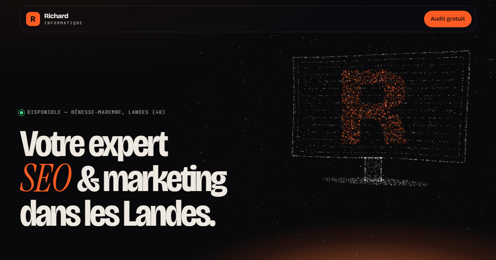

# Richard Informatique Interactive Web Experience

**Site vitrine interactif · Front-end engineering · Creative development**

[](https://github.com/ridev-lab/richard-informatique/actions/workflows/ci.yml)

**[Voir le site en ligne](https://richard-informatique.com/)** · **[Architecture technique](docs/ARCHITECTURE.md)**



## Présentation

Site professionnel réalisé en **JavaScript natif et CSS**, avec une approche *creative development* : scène WebGL, animations pilotées par le défilement, transitions interactives et contenu accessible en HTML dès le chargement. Le projet est compilé avec Vite et déployé en tant que site statique.

L'objectif technique est de concilier une identité visuelle marquée, des interactions fluides et une base légère, sans framework d'interface côté client.

## Stack

| Domaine | Technologies |
| --- | --- |
| Interface | HTML5, CSS3, JavaScript ES Modules |
| 3D / GPU | Three.js, WebGL, shaders GLSL personnalisés |
| Motion design | GSAP, ScrollTrigger, SplitText |
| Scroll | Lenis synchronisé avec GSAP |
| Build | Vite 6, npm |
| Typographie | Fontsource (via dépendances npm) |
| Intégration | FormSubmit, Google Analytics avec choix de consentement |

## Réalisations techniques

- **Scène 3D procédurale** : jusqu'à **16 000 particules** sur grand écran (**7 500** dans la configuration mobile), avec morphing entre plusieurs formes grâce aux shaders personnalisés et à une timeline GSAP.
- **Narration au défilement** : section d'accueil épinglée, transitions synchronisées à ScrollTrigger, animations de services et réalisations.
- **Micro-interactions** : boutons magnétiques, curseur personnalisé, préchargement, effets de révélation et compteurs animés.
- **Responsive & préférences utilisateur** : adaptation de la densité de particules, du pixel ratio et du défilement amorti ; mode de repli lorsque WebGL est indisponible et prise en compte de `prefers-reduced-motion`.
- **Formulaire multi-étapes** : validation côté client, envoi via FormSubmit et solution de repli par e-mail.
- **Structure web exploitable sans JavaScript** : contenu HTML, pages légales et 404 distinctes, métadonnées Open Graph, JSON-LD, sitemap et règles HTTP de mise en cache.

## Architecture du projet

```text
├── index.html                      # Page d'accueil, contenu et métadonnées
├── 404.html                        # Page d'erreur
├── mentions-legales/index.html    # Page juridique
├── public/                         # Favicon, visuels, sitemap et .htaccess
├── src/
│   ├── main.js                     # Initialisation de l'expérience principale
│   ├── page.js                     # Pages secondaires
│   ├── styles/main.css             # Design system et responsive
│   └── js/
│       ├── hero/                   # WebGL, morphing, shaders et timeline GSAP
│       ├── sections.js             # Animations des sections du site
│       ├── smooth.js               # Intégration Lenis / ScrollTrigger
│       ├── ui.js                   # Navigation, interactions et consentement
│       ├── contact.js              # Formulaire multi-étapes
│       └── utils.js                # Helpers DOM
├── scripts/                         # Vérifications et emballage du build
└── vite.config.js                  # Multi-page build & code splitting
```

## Installation locale

**Prérequis :** Node.js 22 recommandé et npm.

```bash
git clone https://github.com/ridev-lab/richard-informatique.git
cd richard-informatique
npm ci
npm run dev
```

Le serveur Vite affiche l'URL locale à ouvrir. Pour générer une version statique :

```bash
npm run check
npm run build
npm run preview
```

Le build place les fichiers déployables dans `dist/`. Le workflow GitHub Actions vérifie la syntaxe des sources et exécute le build à chaque push / pull request.

## Structure & choix d'implémentation

La composition et l'interaction du hero sont réparties entre la géométrie, les shaders et le pilotage GSAP. Le HTML conserve le contenu éditorial ; JavaScript fournit les animations et l'interactivité. Les dépendances sont déclarées dans `package.json` et les bibliothèques ne sont pas vendues avec le dépôt.

[Lire l'explication de l'architecture](docs/ARCHITECTURE.md).

## Contexte

Ce dépôt présente le **code source du site de Richard Informatique**, une réalisation professionnelle personnelle. Les images des projets visibles sur le site sont des illustrations du portfolio client. Ce dépôt est un exemple de développement front-end ; il ne représente pas les sources des autres projets clients.

**© Richard Informatique.** Code présenté à des fins de portfolio et de revue technique. Aucune licence de réutilisation n'est accordée par défaut. Les bibliothèques et ressources tierces conservent leurs licences respectives.
