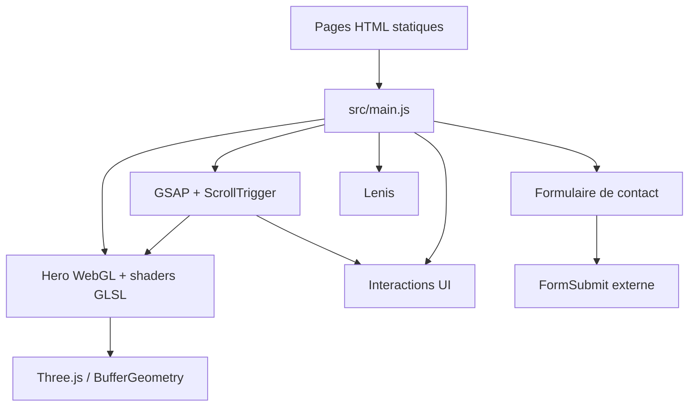

# Architecture — Richard Informatique V2

## Vue d'ensemble

Le site est une application **statique multipage** compilée avec Vite. Il utilise HTML pour la structure des pages et JavaScript ES Modules pour l'expérience interactive. Le déploiement ne nécessite aucun backend Node.js.

## Scene hero : GPU & mouvement

- `src/js/hero/shapes.js` prépare les formes utilisées par les particules.
- `src/js/hero/shaders.js` définit les shaders GLSL, dont le morphing est paramétré par des uniforms.
- `src/js/hero/scene.js` construit `BufferGeometry`, `ShaderMaterial`, la caméra, la scène Three.js et adapte le nombre de particules (**16 000 / 7 500** selon la taille de l'écran).
- `src/js/hero/hero.js` synchronise la progression des formes avec une timeline GSAP `ScrollTrigger` (hero épinglé, défilement progressif).
- Le renderer possède un chemin de repli lorsque WebGL n'est pas disponible ; `ResizeObserver` gère les variations de taille.

## Animation et sections

- `src/js/sections.js` orchestre les visualisations des services, les chiffres, les réalisations et les animations à l'entrée dans la page.
- `src/js/smooth.js` intègre Lenis et synchronise son horloge avec le ticker GSAP et `ScrollTrigger`.
- `src/js/ui.js` gère le menu, le curseur, les interactions magnétiques, le chargement et le consentement analytique.
- `prefers-reduced-motion` coupe le défilement amorti et réduit certaines animations continues.

## Formulaire et analytics

`src/js/contact.js` gère la navigation entre trois étapes, les contrôles de saisie et l'envoi via une API externe FormSubmit, avec un repli par e-mail. Le formulaire ne contient pas de backend personnel dans ce dépôt. Le frontend utilise une adresse professionnelle publique comme destinataire.

`src/js/ui.js` charge Google Analytics seulement après l'action d'acceptation prévue par l'interface de consentement. Le measurement ID public n'est pas un mot de passe ni une clé privée.

## Build et diffusion

- `vite.config.js` définit des entrées pour l'accueil, les mentions légales et la page 404.
- Le code splitting isole des chunks spécifiques à Three.js et aux animations GSAP.
- `public/.htaccess` contient les redirections et entêtes de cache/compresseurs destinés à l'hébergement Apache / LiteSpeed.
- Le contenu SEO, le JSON-LD et les pages accessibles au crawl figurent dans les fichiers HTML d'origine.

## Validation

- `npm run check` valide la syntaxe des fichiers JavaScript source et des fichiers structurants du projet sans dépendances installées.
- `npm run build` génère `dist/`.
- `.github/workflows/ci.yml` effectue ces étapes sous Node.js 22.

Les mesures de performance (Lighthouse, Core Web Vitals) ne sont pas annoncées ici sans audit mesuré sur le site déployé.
