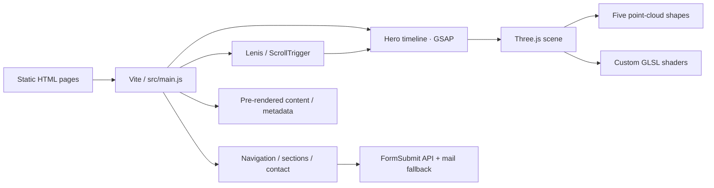

# Engineering case study — Richard Informatique V2

> **Role:** design and implementation of the professional website · **Type:** static, multi-page site · **Source:** [repository root](../README.md) · **Live:** [richard-informatique.com](https://richard-informatique.com/)

This case study describes **implemented code**, not planned features or unverified performance benchmarks.

## The brief

Develop a distinctive company website with a cinematic, scroll-driven introduction while keeping the underlying pages accessible to search engines, deployable as static files and usable across different devices. The interface was built without a client-side UI framework; HTML is responsible for the page content, while JavaScript adds motion, WebGL and interactions.

### The resulting architecture

The boundaries are deliberate: `shapes.js` constructs geometry data, `shaders.js` handles GPU animation, `scene.js` owns the renderer lifecycle, and `hero.js` coordinates the scroll narrative.

## 1. GPU-driven particle morphing

**Source:** [`src/js/hero/shapes.js`](../src/js/hero/shapes.js), [`shaders.js`](../src/js/hero/shaders.js), [`scene.js`](../src/js/hero/scene.js).

The hero moves through five states: **Signal → Bruit → Réseau → Croissance → Système**. Each state generates the same number of points, allowing the vertex shader to interpolate the position of particle *i* between successive shapes.

- A `BufferGeometry` stores the five position attributes and extra data for accent colour, variation and displacement.
- A custom `ShaderMaterial` animates interpolation, simplex-noise drift, intro transitions and pointer repulsion in GLSL.
- The fragment shader handles particle shape, alpha and two-tone colour mixing.
- The CPU updates uniforms each frame; the shader computes per-particle transformations.

**Responsive rendering:** the code uses **16,000 points** for larger layouts and **7,500** on smaller screens. Device pixel ratio is capped at **1.75** or **1.5** respectively. These are implementation settings, not claims of a measured FPS improvement.

## 2. Scroll narrative and animation orchestration

**Source:** [`hero.js`](../src/js/hero/hero.js), [`smooth.js`](../src/js/smooth.js), [`main.js`](../src/main.js).

A pinned `ScrollTrigger` timeline advances a small shared state object (`progress`, `rotX`, `rotY`, `camZ`, `opacity`). The Three.js scene reads that state on its render loop. This separates **timeline choreography** from **GPU scene implementation**.

Lenis is synchronised with GSAP's ticker and `ScrollTrigger.update`. The main entry point starts with a stopped scroll engine, waits briefly for selected fonts, builds the pinned sections in document order, reveals the page through a preloader and refreshes scroll measurements.

### Why this split matters

The hero's geometry and shaders can evolve without rewriting section timelines. Similarly, the scroll timings can be adjusted without manipulating individual particle buffers from animation code.

## 3. Progressive enhancement and device constraints

**Source:** [`scene.js`](../src/js/hero/scene.js), [`hero.js`](../src/js/hero/hero.js), [`smooth.js`](../src/js/smooth.js).

- A failed WebGL renderer creation produces a **no-WebGL fallback**, rather than preventing the page from initialising.
- `ResizeObserver` updates renderer size and camera projection to follow the canvas dimensions.
- The scene manages GPU resource cleanup with `dispose()` and removes its pointer listeners.
- `prefers-reduced-motion` is considered during initialisation; in particular, smooth scrolling is replaced with native scrolling and continuous motion is reduced.
- The main page structure and search-oriented metadata exist directly in the HTML.

This improves resilience, but should **not** be interpreted as a formal accessibility audit.

## 4. Business interactions without a custom backend

**Source:** [`src/js/contact.js`](../src/js/contact.js).

The contact flow uses three steps: service selection, project description and contact details. It validates required client-side fields and submits via **FormSubmit**. When network delivery fails, a `mailto:` fallback prepares the same enquiry for the visitor's mail app.

The public contact address and external service endpoint are part of the website's intended operation; there is **no custom server-side form API** in this repository. The frontend validation is a usability measure, not an anti-abuse or server-side security boundary.

## 5. Build, delivery and verification

**Source:** [`vite.config.js`](../vite.config.js), [`scripts/check-source.mjs`](../scripts/check-source.mjs), [`ci.yml`](../.github/workflows/ci.yml).

- Vite builds three HTML entries: the homepage, legal page and 404 page.
- The output separates major Three.js and GSAP dependencies into chunks.
- Static assets, metadata, sitemap and host-specific HTTP configuration are versioned alongside the source.
- `npm run check` verifies required source files, JavaScript syntax and basic homepage structure.
- GitHub Actions installs dependencies, runs the source checks and performs a production build.

**Verification boundary:** passing syntax and build checks demonstrates that the source compiles in CI. It does not establish browser-level correctness, cross-device performance, Lighthouse scores or full automated end-to-end coverage.

## Engineering trade-offs

| Decision | Benefit | Trade-off |
| --- | --- | --- |
| Native JS modules instead of a SPA framework | Static HTML remains central, smaller conceptual surface for this site | UI state is managed manually |
| GPU morphing with shared attributes | Rich transitions across five shapes | WebGL availability and GPU cost must be considered |
| Fixed point counts by layout | Predictable particle budget at initialisation | Not an adaptive FPS controller |
| Lenis + ScrollTrigger | One coherent scroll animation timeline | Requires careful refresh and lifecycle coordination |
| Third-party form endpoint | No custom backend to host | External service dependency and limited server-side control |
| Vite multi-page build | Small static deployment surface | Backend business logic must live outside this site |

## Further improvements worth testing

- Test the experience with automated real-browser interaction flows.
- Measure LCP, CLS, INP and GPU/frame behaviour on representative devices before quoting performance gains.
- Add nonvisual interaction and keyboard-navigation checks as part of an accessibility review.
- Review form delivery and anti-spam options if the enquiry volume increases.

---

**Related reading:** [Project README](../README.md) · [Architecture notes](ARCHITECTURE.md) · [CI workflow](../.github/workflows/ci.yml)
